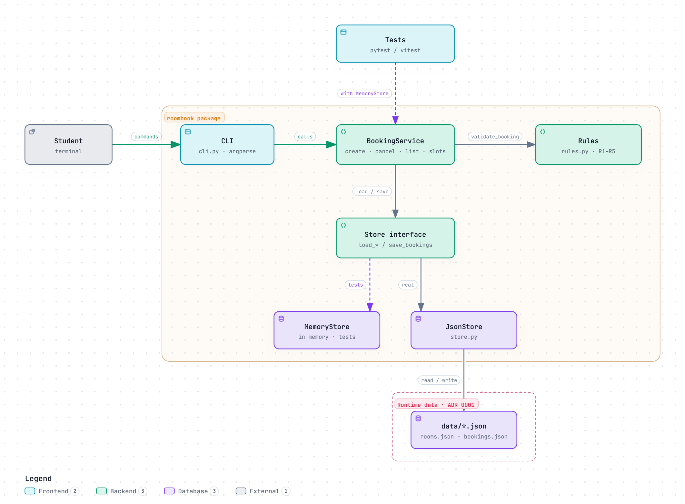

# roombook · Study-room booking at the Kinneret library

The practice repo for the **Software Development with Claude** workshop (Matan Technology Solutions · Matan AI).
TypeScript version (Node 20+). An identical Python version lives in the `roombook-py` repo.

## Setup
```bash
npm install
```
Requires Node.js 20 or later. No external runtime dependencies (only `tsx`, `typescript`, `vitest` for development).

## Tests and lint
```bash
npm test           # all tests (vitest)
npm run lint       # type check (tsc --noEmit)
```

## CLI usage
```bash
npm start -- rooms
npm start -- list --room R101 --day 2026-12-06
npm start -- free --room R101 --day 2026-12-06 --minutes 60
npm start -- book --room R101 --student 315000111 --start 2026-12-06T12:00 --end 2026-12-06T13:00 --group 3
npm start -- cancel --id a1b2c3d4
```

## Architecture
<picture>
  <source media="(prefers-color-scheme: dark)" srcset="docs/architecture-dark.png">
  
</picture>

The layers of this repo (file names in the picture are from the Python twin; here they are `src/cli.ts`, `src/service.ts`, `src/rules.ts`, `src/store.ts`): the CLI only parses and prints, `BookingService` owns the behaviour, the rules are pure functions (testable without files), and storage sits behind a store with a JSON and an in-memory implementation.

## Project map
```
src/
  models.ts    Room, Booking, date helpers (at, day, hhmm)
  rules.ts     rules R1–R5: openingHours, overlaps, validateBooking
  service.ts   BookingService: createBooking / cancelBooking / listBookings / freeSlots
  store.ts     JsonStore (files) and MemoryStore (tests)
  cli.ts       command line
data/          rooms.json, bookings.json — never edit by hand
tests/         vitest
docs/specs/    specs. 0000 = booking rules, TEMPLATE.md = template for a new spec
docs/adr/      architecture decisions
docs/issues/   workshop tasks (001–004)
```

## Workshop tasks
| issue | session | topic |
| --- | --- | --- |
| 001 | 2 | bug: back-to-back bookings are rejected |
| 002 | 2 (bonus) | bug: Friday hours |
| 003 | 4 | feature: waitlist (spec + TDD) |
| 004 | 5 | feature: weekly recurring booking (in pairs, PR) |

`CLAUDE.md.example` is a skeleton — in Session 3 you turn it into a real `CLAUDE.md`.
